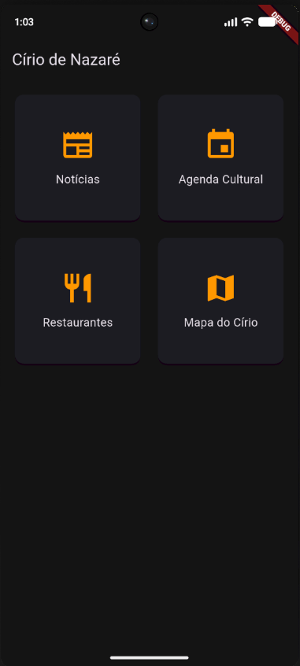
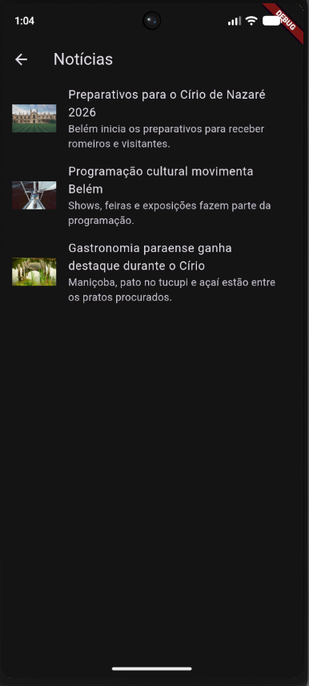
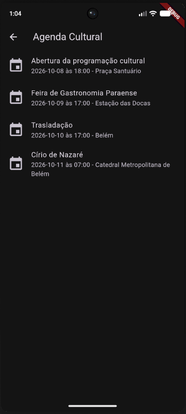
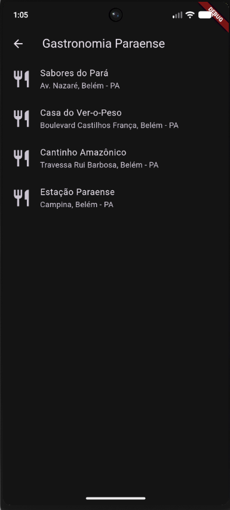
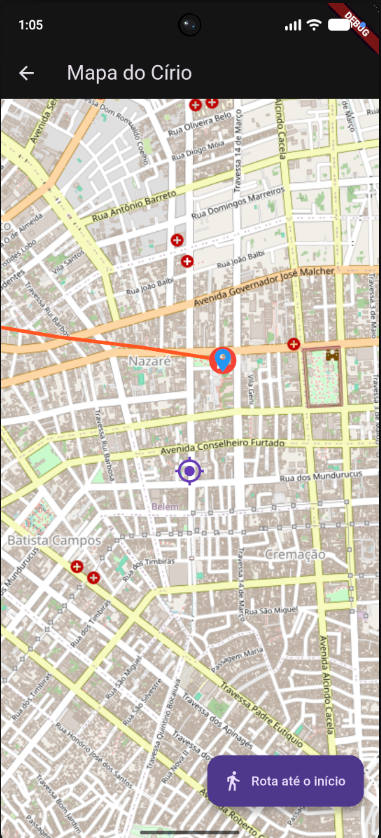
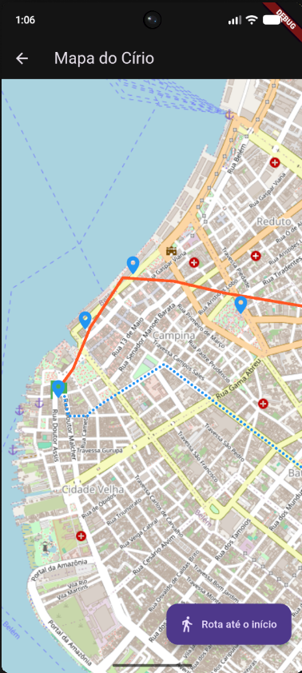

# Círio de Nazaré — App Mobile

Aplicativo Flutter para acompanhar a programação do Círio de Nazaré em Belém: notícias, agenda cultural, restaurantes de culinária paraense e mapa do percurso da procissão. Todas as informações vêm de uma API REST, sem dados fixos no código.

> Projeto da disciplina de Laboratório de Programação Mobile — CESUPA. A API REST é fornecida pelo professor.

## Funcionalidades

- Notícias com título, data, resumo, imagem e conteúdo, com tela de detalhes
- Agenda cultural com nome, descrição, data, horário e local
- Restaurantes com descrição, endereço e especialidades
- Mapa (`flutter_map`) com a sua posição, o início e a chegada da procissão, pontos relevantes e o percurso completo
- Rota entre a sua posição e o início da procissão, desenhada em estilo diferente do percurso oficial
- Sensor de luz: o app troca para o tema escuro em ambientes escuros
- Chacoalhar o celular recentraliza o mapa na sua localização

## Em andamento

- [ ] Seta de orientação por bússola até o início da procissão
- [ ] Posição do restaurante no mapa, na tela de detalhes

## Tecnologias

Flutter · Dart · `http` · `flutter_map` · `latlong2` · `geolocator` · `shake` · `light_sensor`

## Como rodar

Pré-requisitos: [Flutter](https://docs.flutter.dev/get-started/install) instalado (confira com `flutter doctor`) e um celular Android com depuração USB ativada. Um aparelho real é o ideal, por causa do GPS e dos sensores.

```bash
git clone https://github.com/HugooMonteiro/cirio-nazare-app.git
cd cirio-nazare-app
flutter pub get
flutter run
```

O app precisa de internet e das permissões de localização, que já estão declaradas no `AndroidManifest.xml`:

```xml
<uses-permission android:name="android.permission.INTERNET"/>
<uses-permission android:name="android.permission.ACCESS_FINE_LOCATION"/>
<uses-permission android:name="android.permission.ACCESS_COARSE_LOCATION"/>
```

O endereço da API fica em `lib/services/api_service.dart` (`baseUrl`).

## Estrutura

```
lib/
  main.dart            tema claro/escuro pelo sensor de luz
  models/              Noticia, Evento, Restaurante, TrajetoCirio, PontoImportante, RotaAteInicio
  services/            api_service.dart (consumo da API REST)
  screens/             home, notícias, agenda, restaurantes e mapa (com telas de detalhe)
```

## Prints

<p>
  
  
  
  
  
  
</p>

## Autor

Hugo de Oliveira Monteiro — estudante de Engenharia de Computação, CESUPA